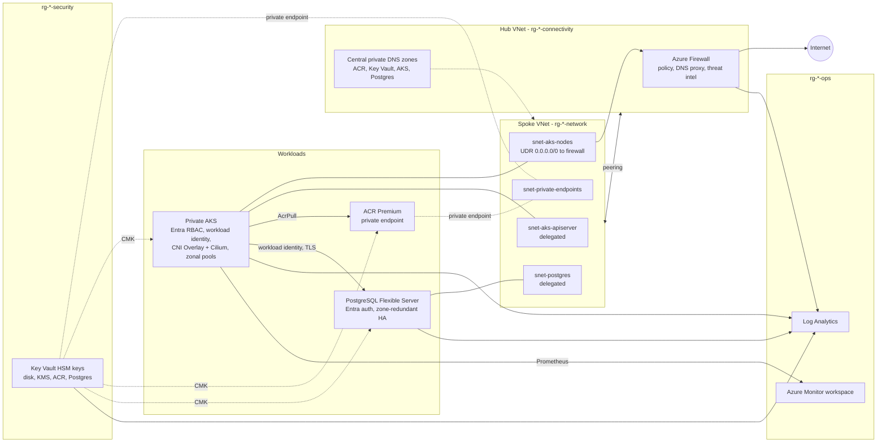
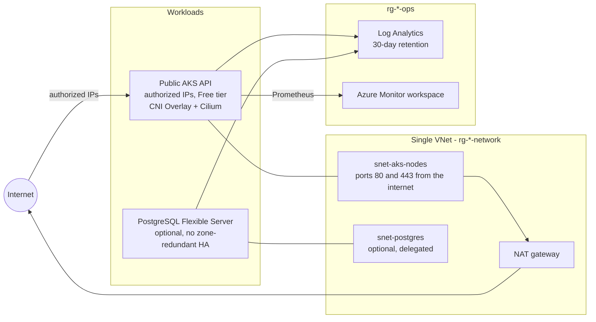

# Azure AKS reference platform

[](https://developer.hashicorp.com/terraform/language)
[](https://registry.terraform.io/providers/hashicorp/azurerm/latest/docs)
[](LICENSE)

Terraform modules for a production-grade Azure Kubernetes Service platform. The modules cover:

- hub-and-spoke networking with Azure Firewall
- a hardened private AKS cluster
- a private Azure Container Registry
- a private PostgreSQL Flexible Server
- customer-managed keys in Key Vault
- Terraform state storage
- Entra ID app registrations

The modules follow the
[AKS baseline architecture](https://learn.microsoft.com/azure/architecture/reference-architectures/containers/aks/baseline-aks),
the [Azure Well-Architected Framework](https://learn.microsoft.com/azure/well-architected/), and
[Azure Verified Modules](https://azure.github.io/Azure-Verified-Modules/) conventions.

## Architecture

The two roots are different topologies. Dev is not a smaller copy of prod.

### Production

[`environments/prod`](environments/prod) ([README](environments/prod/README.md)) is this layout.
Variable defaults are the full platform drawn below. `terraform.tfvars.example` is a smaller
smoke test; that README records what was applied.



### Development

[`environments/dev`](environments/dev) ([README](environments/dev/README.md)) is one VNet.
Egress is a NAT gateway. The API server is public, limited to authorized IPs, including the
NAT address so nodes can reach it. There is no hub, firewall, Key Vault, registry, or
customer-managed key. PostgreSQL is off unless `postgres_enabled` is set. The committed
example is the verified sandbox profile; the dev README records what was applied.



## Modules

| Module | Purpose |
|--------|---------|
| [`hub-network`](modules/hub-network) | Hub VNet, Azure Firewall with policy and AKS egress rules, central private DNS zones |
| [`network`](modules/network) | Spoke VNet, NSG per subnet, NAT gateway or firewall egress (UDR), hub peering |
| [`aks`](modules/aks) | AKS cluster, node pools, identities, monitoring, CMK disk and etcd encryption, optional Flux GitOps |
| [`container-registry`](modules/container-registry) | Private Premium ACR, Entra-only access, optional CMK and geo-replication |
| [`key-vault`](modules/key-vault) | RBAC-only Key Vault with purge protection and auto-rotating HSM keys for CMK |
| [`postgresql-flexible-server`](modules/postgresql-flexible-server) | Private PostgreSQL with Entra auth, HA, backups, private DNS, optional CMK |
| [`storage-backend`](modules/storage-backend) | Entra-only, locked, versioned storage for Terraform state |
| [`entra-app-registration`](modules/entra-app-registration) | OIDC app registration with rotating secret or federated credentials |
| [`alerting`](modules/alerting) | Recommended alerts for AKS, PostgreSQL, the firewall and Key Vault, plus health events and a budget |
| [`keycloak`](modules/keycloak) | Keycloak realm configuration: OIDC clients with PKCE, roles, groups, and Entra ID, Google and OIDC identity brokering |

The Keycloak modules are not part of the Azure platform. They configure a Keycloak realm for
applications that need their own login, and Keycloak itself would run wherever you host it, for
example on the cluster through GitOps. They live here so the application story sits next to the
platform. A later split would move them to their own repository.

## Environments and bootstrap

Root configurations mirror how a real platform team lays out a work repository: **environments**
hold deployable stacks (separate state per folder); **bootstrap** holds one-off shared setup.

| Path | Topology | When to use |
|------|----------|-------------|
| [`environments/dev`](environments/dev) | Single VNet, NAT gateway egress, public API server with authorized IPs | Dev/test, or a subscription without a hub |
| [`environments/prod`](environments/prod) | Hub and spoke, firewall egress, private cluster, private ACR and Key Vault, CMK, alerting. PostgreSQL and Flux follow the variable defaults; the committed example turns both off | Production-shaped reference. The example file is the smoke test |
| [`bootstrap/github-actions-identity`](bootstrap/github-actions-identity) | OIDC identities for the plan/apply pipeline | One-off CI setup (after state storage exists) |

In-cluster configuration (cert-manager, the sample workload) lives in [`gitops/`](gitops) and is
reconciled by Flux, not applied by Terraform.

## Design decisions

The full reasoning behind each decision is recorded in [architecture decision records](docs/adr).
Operational procedures are not written yet; [docs/runbooks](docs/runbooks) lists the ones still to come.

- **Separation by lifecycle.** Network, cluster, registry, keys and database are separate modules
  with separate resource groups. The database and registry outlive cluster rebuilds and
  blue/green cluster upgrades, and each layer can be owned by a different team.
- **Controlled egress.** In production, all spoke traffic to the internet leaves through Azure
  Firewall. The firewall allows only the endpoints AKS needs, using the `AzureKubernetesService`
  FQDN tag, and denies everything else, with threat intelligence enabled.
- **Private by default.** The API server, ACR, Key Vault and PostgreSQL have no public endpoints
  in the production example. Name resolution goes through central private DNS zones in the hub,
  served by the firewall DNS proxy.
- **Customer-managed keys where compliance asks for them.** Azure encrypts everything at rest
  with platform keys by default. CMK adds key ownership, revocation and an audit trail, at the
  cost of key management. The production example enables it for disks, etcd secrets, ACR and
  PostgreSQL; the dev environment does not.
- **Modules don't configure providers.** Callers own provider configuration, which keeps modules
  composable (`for_each`, `depends_on`) and keeps credentials out of module inputs.
- **Terraform stops at the cluster boundary.** In-cluster software (ingress, cert-manager,
  policies, apps) is delivered by GitOps (the Flux extension), not by Helm and Kubernetes
  providers in the same apply.
- **Identity over secrets.** Local cluster accounts, ACR admin users, storage shared keys and
  Postgres passwords are disabled by default. Humans use Entra groups; workloads use workload
  identity and managed identities.
- **Secure by default, relaxed explicitly.** Defaults target production; development opts out.

## Getting started

Prerequisites: Terraform ≥ 1.11, Azure CLI, and permissions to create role assignments (Owner or
User Access Administrator on the target scope).

```sh
# 1. Bootstrap remote state (one-off)
cd modules/storage-backend/examples/bootstrap
terraform init && terraform apply -var storage_account_name=sttfstate<unique>

# 2. Deploy an environment (dev or prod)
cd ../../../../environments/prod
cp backend.hcl.example backend.hcl            # point to the state account
cp terraform.tfvars.example terraform.tfvars  # smoke test; replace the group ID and the documentation IP
export ARM_SUBSCRIPTION_ID=<subscription-id>
terraform init -backend-config=backend.hcl
terraform plan -out tfplan && terraform apply tfplan
```

Considerations for the production example:

- **Where Terraform runs.** Key Vault keys are created through the data plane, and the vault is
  private. Run Terraform from a self-hosted runner that can reach the spoke (set the
  `TERRAFORM_RUNNER` GitHub variable), temporarily allow your runner IP with `operator_ip_ranges`,
  or use the hub **Azure Bastion** host (`terraform output operator_access`).
- **Cluster access.** The API server is private. Use `az aks command invoke` (see
  `aks_command_invoke_example`), connect through Bastion to a jump VM in the spoke, or use a runner
  in the network. `vpn_gateway_enabled = true` adds a point-to-site gateway for a laptop; it is
  off by default and still needs private DNS for `kubectl`. North–south HTTP(S) to workloads uses the managed application routing add-on
  (`app-routing-system`), aligned with the GitOps sample API NetworkPolicy.
- **Host encryption** requires the `Microsoft.Compute/EncryptionAtHost` feature on the
  subscription. Register it, or set `host_encryption_enabled = false`.
- **Cost.** Azure Firewall, zone-redundant PostgreSQL HA and Premium ACR/Key Vault account for
  most of the baseline cost. In an enterprise landing zone, the hub is usually shared and
  provided by a platform team.

## Quality gates

Every module and example is checked in CI ([`.github/workflows/terraform.yml`](.github/workflows/terraform.yml))
on Terraform `1.11.0` and on the latest release, so the `>= 1.11` constraint is tested at both
ends. The production plan and apply workflow is pinned to `1.11.0`, the same CLI as the minimum check.

- `terraform fmt`, `terraform validate` and `tflint` (with the Azure ruleset)
- `terraform test` with mocked providers. These plan every module and example without
  Azure credentials, and they assert on security defaults and input validation.
- `terraform-docs --output-check`, so the generated reference tables in the module READMEs stay
  in sync with the variables and outputs
- `trivy config` misconfiguration scanning, with accepted findings documented in
  [`.trivyignore`](.trivyignore), and `actionlint` for the workflows

[`.github/workflows/gitops.yml`](.github/workflows/gitops.yml) is separate. It runs
`scripts/check-gitops.sh` when `gitops/` changes: `kustomize build` of the Flux entry points,
then kubeconform against Kubernetes 1.36 and the Flux CRD schemas. It does not apply Azure.

[`.github/workflows/deploy-production.yml`](.github/workflows/deploy-production.yml) plans on pull
requests and applies on `main` after a protected environment approves, authenticating with
OpenID Connect ([ADR 0008](docs/adr/0008-oidc-for-cicd-with-least-privilege.md)).

Locally, `pre-commit install` (from [`.pre-commit-config.yaml`](.pre-commit-config.yaml)) runs the
same checks before each commit, and [Renovate](renovate.json) proposes provider and action updates.

Run locally:

```sh
scripts/check.sh                 # everything
scripts/check.sh modules/aks     # one module
```

## AI-assisted development

The repo includes context for AI coding agents, so their changes follow the same conventions
and quality gates as a human contributor's:

| Path | Purpose |
|------|---------|
| [`AGENTS.md`](AGENTS.md) | Tool-neutral instructions: layout, hard rules, conventions, azurerm v5 gotchas, definition of done |
| [`CLAUDE.md`](CLAUDE.md) | Imports `AGENTS.md` for Claude Code, so there is one source of truth |
| [`.cursor/rules/`](.cursor/rules) | Scoped rules: module conventions (`*.tf`), test conventions (`*.tftest.hcl`), safety (always) |
| [`.cursor/skills/`](.cursor/skills) | `add-terraform-module` (scaffold, test, document, wire into CI) and `run-quality-gates` |
| [`.cursor/agents/`](.cursor/agents) | `terraform-reviewer` subagent for security and convention review |

Agents verify changes with plan-only tests and are never allowed to apply infrastructure.

## Possible extensions

- Self-hosted CI runners (Container Apps jobs or a VM scale set) in the spoke for private deployments
- Firewall Premium with TLS inspection, and Application Gateway for Containers with WAF for ingress
- Prometheus recording rules and Azure Managed Grafana dashboards
- Multi-region active/passive with ACR geo-replication and Postgres read replicas
